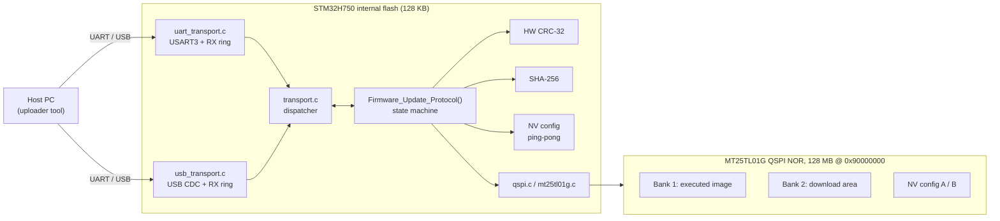
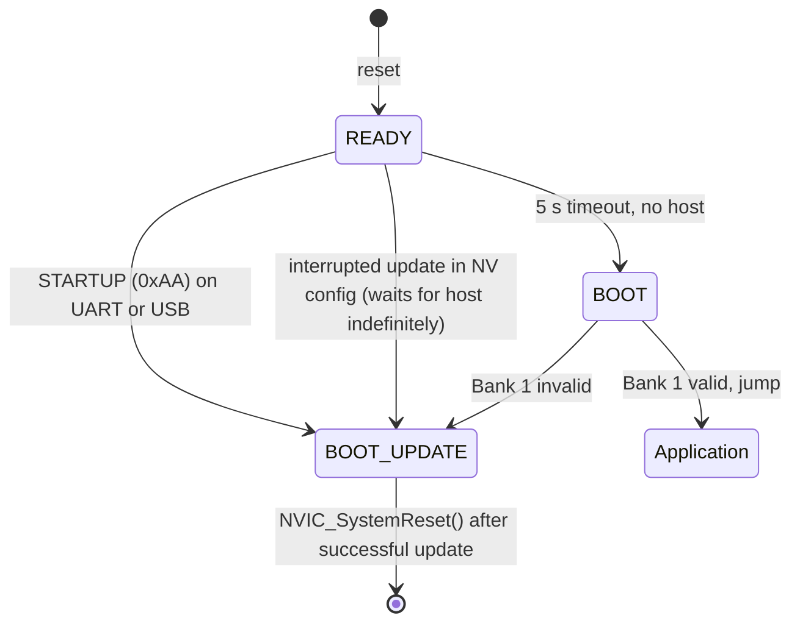
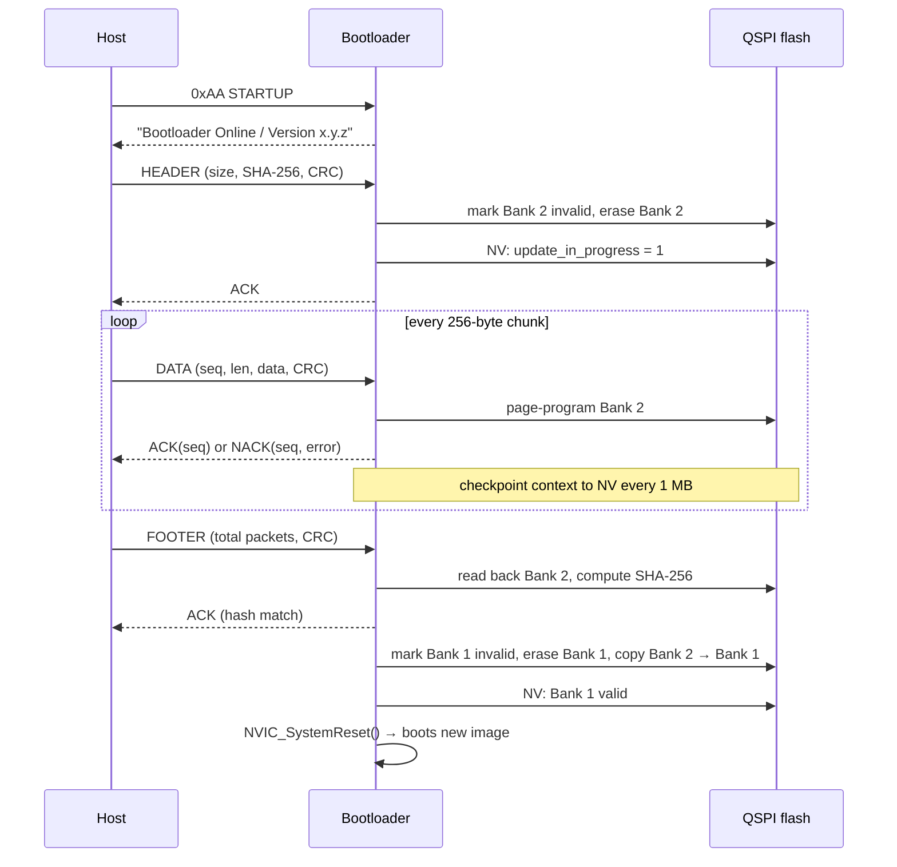

# STM32H750B-DK Fail-Safe Dual-Bank Bootloader

A bare-metal bootloader for the **STM32H750B-DK** that updates application firmware stored in **128 MB of external QSPI NOR flash** over **UART or USB CDC**. It is designed so that a power cut, a cable pull, or a crash at any point of an update leaves the board bootable or recoverable.

| | |
|---|---|
| **Version** | 0.1.0 (basic bootloader, no auto-reset) |
| **Target** | STM32H750XBH6, Arm Cortex-M7 @ 480 MHz |
| **Language** | C (bare-metal, STM32 HAL) |
| **Toolchain** | STM32CubeIDE / arm-none-eabi-gcc |
| **Author** | Shaman Karunaratne |

---

## Table of Contents

- [Highlights](#highlights)
- [Why a Bootloader Is Needed](#why-a-bootloader-is-needed)
- [Hardware](#hardware)
- [System Architecture](#system-architecture)
- [Memory Map](#memory-map)
- [Boot Flow](#boot-flow)
- [Update Flow](#update-flow)
- [Wire Protocol](#wire-protocol)
- [Non-Volatile Configuration](#non-volatile-configuration)
- [Getting Started](#getting-started)
- [Preparing an Application](#preparing-an-application)
- [Configuration Reference](#configuration-reference)
- [Design Decisions](#design-decisions)
- [Known Limitations](#known-limitations)
- [Roadmap](#roadmap)
- [Credits](#credits)

---

## Highlights

- **Two transports, one protocol:** UART (USART3) and USB Full-Speed CDC are both polled at boot. The first one to send the sync byte is used for the whole session.
- **Clean transport abstraction:** the update protocol only calls `Transport_Receive()` / `Transport_Transmit()`. Adding a new transport means writing one driver file and adding one `switch` branch.
- **Dual-bank A/B storage:** new firmware goes to a separate download bank and is copied to the executing bank only after it passes verification.
- **End-to-end integrity:** hardware CRC-32 on every packet, plus SHA-256 over the whole image read back from flash.
- **Power-loss-safe config:** two 4 KB config sectors written alternately ("ping-pong") with a commit counter and CRC-32.
- **Resumable updates:** progress is checkpointed every 1 MB. After a reset, the bootloader asks the host to continue from the last checkpoint.
- **Watchdog protected:** IWDG1 runs only during an update (about 512 ms timeout). A hang resets the MCU, and the cause is handled on the next boot.
- **Lock-free I/O:** 2 KB single-producer / single-consumer ring buffers between the UART/USB interrupts and the protocol parser.

---

## Why a Bootloader Is Needed

The STM32H750 is a "value line" part: a 480 MHz Cortex-M7 with only **128 KB of internal flash**. A real application (graphics, assets, connectivity) does not fit there, so it must execute in place (XIP) from external QSPI flash memory-mapped at `0x90000000`. This creates three problems, and the bootloader solves each one:

1. **QSPI must be initialized before the application can run.** The bootloader sits in internal flash, sets up clocks, MPU and QSPI, enables memory-mapped mode, and hands over control.
2. **Updates must never brick the device.** Images are staged, verified, and committed step by step, with every step recorded in power-loss-safe storage.
3. **Jumping into external code on a Cortex-M7 is subtle.** Caches, SysTick, interrupts, and the stack pointer must all be in a known state before the jump.

---

## Hardware

| Item | Details |
|---|---|
| Board | STM32H750B-DK |
| External flash | Micron MT25TL01G QSPI NOR, 128 MB (dual-die), mapped at `0x90000000` |
| UART | USART3, PB10 (TX) / PB11 (RX), **3,686,400 baud, 8N1** (ST-LINK virtual COM port) |
| USB | USB OTG FS (PA11 / PA12), CDC class, enumerates as "STM32 Virtual ComPort" (VID `0x0483`, PID `0x5740`), clocked from HSI48 |
| Status LED | LD1 (PJ2): blinks at startup, blinks continuously on fatal error |

---

## System Architecture



### Repository layout

```
.
├── Core/
│   ├── Inc/
│   │   ├── firmware_protocol.h  Opcodes, packet structs, error codes, NV config layout
│   │   ├── transport.h          Transport dispatcher API
│   │   └── ...
│   ├── Src/
│   │   ├── main.c               Boot flow, state machines, NV config, application jump
│   │   ├── firmware_protocol.c  CRC-32 helper, ACK / NACK framing
│   │   ├── transport.c          Transport dispatcher (only file that knows UART and USB exist)
│   │   ├── uart_transport.c     Interrupt-driven USART3 ring buffer
│   │   ├── usb_transport.c      USB CDC ring buffer fed from CDC_Receive_FS()
│   │   ├── qspi.c               Erase, page program, memory-mapped mode
│   │   ├── mt25tl01g.c          MT25TL01G low-level driver
│   │   ├── sha256.c             SHA-256 implementation
│   │   └── ...                  CubeMX-generated peripheral init
│   └── Startup/                 Startup assembly
├── Drivers/                     STM32H7 HAL and CMSIS
├── Middlewares/                 ST USB Device Library (CDC)
├── USB_DEVICE/                  USB device configuration and CDC interface
├── STM32H750XBHX_FLASH.ld       Bootloader linker script (internal flash @ 0x08000000)
├── bootloader.ioc               STM32CubeMX configuration
└── README.md
```

---

## Memory Map

| Region | Address (offset) | Size | Purpose |
|---|---|---|---|
| Internal flash | `0x0800_0000` | 128 KB | This bootloader |
| QSPI Bank 1 | `0x9000_0000` (`0x0000_0000`) | 64 MB | Application that executes (XIP) |
| QSPI Bank 2 | `0x9400_0000` (`0x0400_0000`) | 64 MB − 8 KB | Download / staging area |
| NV config A | `0x97FF_E000` | 4 KB | Ping-pong config copy A |
| NV config B | `0x97FF_F000` | 4 KB | Ping-pong config copy B |

The application always runs from Bank 1. Bank 2 only holds staged data, and the bootloader never jumps into it.

---

## Boot Flow



### Startup

1. Configure MPU regions and L1 caches, then HAL and the 480 MHz PLL clock tree (HSE), with HSI48 for USB.
2. If the last reset came from the watchdog (`RCC_FLAG_IWDG1RST`), clear the stuck `update_in_progress` flag so the device does not loop on a broken transfer.
3. Initialize GPIO, CRC, USART3, QSPI, USB and the transports, then load the newest valid NV config.
4. Blink LD1 and listen on both UART and USB for `0xAA` for 5 seconds.

### Jump to the application (`MASTER_STATE_BOOT`)

1. If Bank 1 is not marked valid, refuse to boot and enter update mode instead. This is what keeps the device from bricking.
2. Re-enter QSPI memory-mapped mode and de-initialize UART and CRC.
3. Disable the L1 I-cache and D-cache, stop SysTick, and disable interrupts.
4. Load the MSP from `0x90000000` and the reset handler from `0x90000004`, then branch.

---

## Update Flow



| State | What happens |
|---|---|
| `IDLE` | Wait for a HEADER opcode |
| `HEADER_RECEIVED` | Check CRC, mark Bank 2 invalid **before** erasing it, erase the needed sectors, save `update_in_progress` |
| `READY` | For each DATA packet: check sequence, CRC and length, program the page, checkpoint every 1 MB |
| `FOOTER_RECEIVED` | Check the packet count, compute SHA-256 over Bank 2 through the memory-mapped window |
| `UPDATE_DONE` | Mark Bank 1 invalid **before** erasing it, then erase it |
| `BANK1_READY` | Copy Bank 2 → Bank 1 page by page, refreshing the watchdog |
| `FIRMWARE_UPDATED` | Mark Bank 1 valid, commit the NV config, reset |

Every step that changes flash follows the same rule: **record the intent in NV first, then do the destructive operation.** If power is lost in between, the next boot sees the bank flagged invalid and never runs it.

---

## Wire Protocol

All multi-byte fields are little-endian. Each packet's CRC-32 covers every byte before the CRC field and is computed with the STM32 hardware CRC unit (polynomial `0x04C11DB7`).

| Packet | Opcode | Layout | Size |
|---|---|---|---|
| STARTUP | `0xAA` | `[0xAA]` | 1 |
| HEADER | `0x01` | `[op][file_size:4][sha256:32][crc32:4]` | 41 |
| DATA | `0x02` | `[op][seq:2][len:2][data:256][crc32:4]` | 265 |
| FOOTER | `0x03` | `[op][total_packets:2][reserved:1][crc32:4]` | 8 |
| ACK | `0x0A` | `[op][acked_op][seq:2]` | 4 |
| NACK | `0x15` | `[op][nacked_op][seq:2][error]` | 5 |

The DATA payload field is always 256 bytes; `len` gives the number of valid bytes (1–256).

### Error handling

| Error class | Codes | Host action |
|---|---|---|
| Receive timeout / framing | `0x01`, `0x11`, `0x21` | Resend the last un-ACKed packet |
| CRC mismatch | `0x02`, `0x13`, `0x22` | Resend that packet |
| Sequence mismatch | `0x12` | NACK carries the **expected** sequence number; resend from there |
| Wrong state / bad length | `0x10`, `0x14`, `0x20` | Restart from HEADER / resend with valid length |
| Packet count mismatch | `0x23` | Restart the update |
| Image hash mismatch | `0x25` | Fatal for this session; restart from HEADER |
| Flash erase / write failure | `0x03`, `0x15`, `0x24`, `0x26`, `0x27` | Fatal; reset and recover with a fresh update |

The sequence-mismatch NACK also handles **resume after power loss**: on the next boot the bootloader restores its context, re-erases ahead of the last checkpoint, and NACKs with the sequence number it expects. The host continues from there without resending the HEADER.

All codes are defined in `Core/Inc/firmware_protocol.h`.

---

## Non-Volatile Configuration

```c
typedef struct __attribute__((packed)) {
    uint32_t magic_word;          // 0x5AA5C33C
    uint32_t commit_counter;      // incremented on every write; newest copy wins
    uint32_t bank1_status;        // 1 = valid, 0 = invalid
    uint32_t bank2_status;        // 1 = valid, 0 = invalid
    uint32_t update_in_progress;  // resume flag
    BootloaderContext_t boot_ctx; // state, bytes written, seq numbers, expected hash
    uint32_t crc32;               // CRC-32 of everything above (must be last)
} BootloaderNVConfig_t;
```

- **Read:** validate the magic word and CRC of copies A and B. If both are valid, use the one with the higher `commit_counter`.
- **Write:** always write to the copy that was not used last. A power cut can only corrupt the copy being written; the previous good copy survives.
- **From the application:** the QSPI flash stays memory-mapped, so the application can read this structure directly. Copy `BootloaderContext_t` and `BootloaderNVConfig_t` from `firmware_protocol.h` exactly so the layout matches, and treat the region as read-only.

---

## Getting Started

### Requirements

- STM32CubeIDE
- STM32H750B-DK board with a USB cable to the ST-LINK port (and optionally to the USB OTG FS port)

### Build and flash

1. Clone the repository.
2. In STM32CubeIDE, select **File → Import → Existing Projects into Workspace** and choose the repository folder.
3. Build the **Debug** configuration. The output `bootloader.elf` is linked for internal flash at `0x08000000`.
4. Flash it with the on-board ST-LINK (**Run → Debug**, or STM32CubeProgrammer).

On a fresh board, Bank 1 is empty and marked invalid, so the bootloader stays in update mode until an application is uploaded.

### Upload an application

1. Connect through either:
   - **UART:** ST-LINK virtual COM port at 3,686,400 baud, 8N1, or
   - **USB:** the USB OTG FS port (virtual COM port; the baud setting is ignored).
2. Reset the board.
3. Within **5 seconds**, send `0xAA`, then stream the image using the protocol above.
4. On success, the bootloader copies the image to Bank 1, resets, and boots it.

---

## Preparing an Application

Link the application to execute from QSPI Bank 1 and keep its total size under **64 MB − 8 KB**, so it can never reach the NV config area:

```ld
MEMORY
{
  DTCMRAM      (xrw) : ORIGIN = 0x20000000, LENGTH = 128K
  RAM_D1       (xrw) : ORIGIN = 0x24000000, LENGTH = 512K
  FLASH        (rx)  : ORIGIN = 0x90000000, LENGTH = 2048K
  ASSETS_FLASH (r)   : ORIGIN = 0x90200000, LENGTH = 63480K  /* 62 MB - 8 KB */
}
```

Application checklist:

- [ ] Set `SCB->VTOR = 0x90000000` early in `SystemInit()`; the bootloader does not set it.
- [ ] Do not re-initialize QSPI in a way that leaves memory-mapped mode; the application is executing from it.
- [ ] Re-enable interrupts (`__enable_irq()`) during startup; the bootloader jumps with them disabled.
- [ ] Produce a raw binary for upload: `arm-none-eabi-objcopy -O binary app.elf app.bin`.

---

## Configuration Reference

| Setting | Location | Default |
|---|---|---|
| Bootloader version | `BOOTLOADER_VERSION_*` in `Core/Src/main.c` | `0.1.0` |
| Bank 2 offset | `APP_OFFSET` in `Core/Src/main.c` | `0x04000000` |
| Startup listen window | `MASTER_STATE_READY` in `Core/Src/main.c` | 5000 ms |
| Checkpoint interval | `total_bytes_written % (MT25TL01G_SECTOR_SIZE * 16)` in `UPDATE_STATE_READY` | 1 MB |
| Resume re-erase range | Resume block in `Firmware_Update_Protocol()` | 16 sectors (1 MB) |
| Opcodes, packet sizes, error codes | `Core/Inc/firmware_protocol.h` | – |
| UART baud rate | `Core/Src/usart.c` | 3,686,400 |
| RX ring buffer sizes | `UART_RX_RING_SIZE`, `USB_RX_RING_SIZE` | 2048 bytes each |
| Watchdog timeout | `Core/Src/iwdg.c` | Prescaler 4, reload 4095 (~512 ms) |

> If you change the checkpoint interval, change the resume re-erase range to match. Otherwise a resumed update may try to program flash that was not erased.

### Adding a transport

1. Write `xxx_transport.c/.h` with `XXX_Receive()` and `XXX_Transmit()`.
2. Add a value to `ActiveTransport_t` in `Core/Inc/transport.h`.
3. Add a branch to each `switch` in `Core/Src/transport.c`, and poll the new transport for `0xAA` in `MASTER_STATE_READY`.

---

## Design Decisions

- **Copy to Bank 1 instead of executing from either bank.** The application is linked once for `0x90000000`, so it needs no position-independent code. The cost is copy time and extra wear on Bank 1.
- **SHA-256 over flash, not over the received stream.** Hashing what was actually stored also catches QSPI program and read-back errors.
- **Watchdog only during updates.** The application keeps full control of its own watchdog, and the bootloader never resets an application that boots correctly.
- **Poll both transports at boot.** No configuration needed: plug in either cable, and the first to send `0xAA` is used.
- **1 MB checkpoint interval.** Balances NV flash wear (one 4 KB erase per checkpoint) against how much data must be resent after a power loss.

---

## Known Limitations

- **No auto-reset.** A running application cannot put the device into update mode. The board must be reset manually and the host must send `0xAA` within 5 seconds.
- **USB is not stopped before the jump.** `USBD_Stop()` / `USBD_DeInit()` are left commented out pending hardware validation.
- **LTDC and DMA2D are initialized** even though the bootloader does not use the display.
- **No image signing.** SHA-256 protects integrity, not authenticity.

---

## Roadmap

- [ ] Auto-reset: let the application trigger the bootloader so uploads need no manual reset
- [ ] Host-side Python uploader with progress display and automatic resume
- [ ] Stop the USB stack cleanly before the application jump
- [ ] Signed images (ECDSA P-256) on top of SHA-256
- [ ] Rollback if the new application fails a "boot confirmed" handshake

---

## Credits

Written by **Shaman Karunaratne**.

Peripheral initialization is generated by STM32CubeMX. The QSPI / MT25TL01G low-level driver and startup code are adapted from STMicroelectronics reference code, and the SHA-256 core is adapted from Brad Conte's public-domain implementation. The original copyright and license notices are kept in those files.